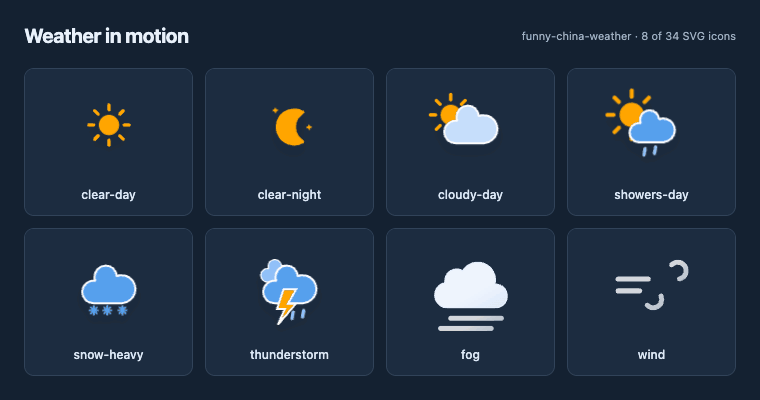
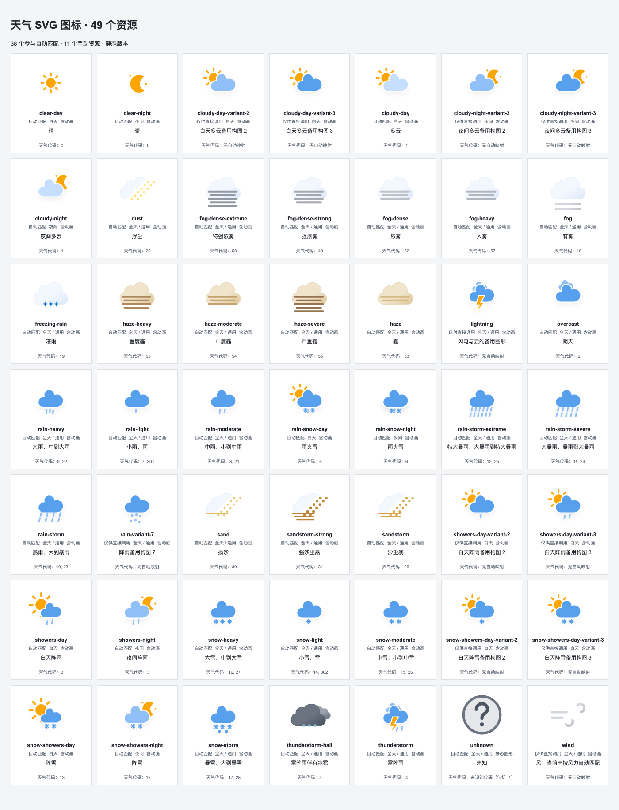

# funny-china-weather

**简体中文** | [English](README.en.md)

[](.github/goreportcard-report.md) [](.github/go-test-report.md)

一个轻量的 Go 天气库：查询中国境内城市的实时天气，根据出口 IP 定位，并按天气代码选择可直接嵌入页面的 SVG 图标。适合个人主页、仪表盘和 Flare 等应用。

- 内置 **34 个 SVG 图标**，支持昼夜切换、动画和静态版本。
- 提供温度、湿度、天气描述和上游更新时间，支持通过 `context` 取消请求。
- 仅依赖 Go 标准库。天气查询和 IP 定位需要联网；图标选择与 SVG 读取可离线使用。

## 图标预览

下面展示晴天、晴夜、多云、阵雨、大雪、雷雨、雾和风的动画效果。动图约 **252 KB**；下载仓库后，可在浏览器中打开 [完整交互画廊](docs/icon-preview.html)，搜索图标、切换浅色/深色画布，或查看静态版本。

[](docs/icon-preview.html)

<details>
<summary>查看全部 34 个图标的静态总览</summary>

[](docs/icon-preview.html)

</details>

## 安装与快速开始

需要 **Go 1.27.3 或更高版本**。

```sh
go get github.com/soulteary/funny-china-weather@main
```

以下接口属于当前开发版，安装命令使用 `@main`。

**地点选择方式请参考 [腾讯天气](https://tianqi.qq.com/)**：搜索后选中具体的市、区或县，保留该地点对应的省、市、区县字段。同名地点需要结合上级地区确认。

下面以腾讯天气中的“湖南 → 常德 → 津市”为例，查询天气并取得图标名称：

```go
package main

import (
    "context"
    "fmt"
    "log"
    "time"

    weather "github.com/soulteary/funny-china-weather"
)

func main() {
    ctx, cancel := context.WithTimeout(context.Background(), 3*time.Second)
    defer cancel()

    selected := weather.Location{
        Province: "湖南",
        City:     "常德",
        County:   "津市",
    }
    observation, err := weather.GetObservationAt(ctx, selected)
    if err != nil {
        log.Fatal(err)
    }
    key, description := weather.GetWeatherIconByCode(observation.Code)
    fmt.Printf("%d°C, %d%% humidity, %s (%s), updated %s\n",
        observation.TemperatureC, observation.HumidityPercent,
        description, key, observation.UpdateTime)
}
```

`Observation` 包含天气代码、摄氏温度、相对湿度（整数百分比）、天气描述和上游原始更新时间。时间字符串通常形如 `202610250745`（`YYYYMMDDHHMM`），查询时保留原值。未知整数天气代码仍是有效观测数据，图标使用 `unknown` 兜底。

从 v0.2.0 升级时，请先阅读 [图标命名与迁移说明](docs/icon-names.md)。v0.3.0 移除了旧图标名称，未提供别名；直接传递选择器结果的调用方式保持兼容。Flare 升级后应重启以清除旧缓存。

## 查询天气

### 搜索并选择具体地点

使用方式与 [腾讯天气](https://tianqi.qq.com/) 的地点选择一致：**输入关键词 → 查看候选 → 确认具体地点 → 查询天气**。例如“朝阳”可能对应不同省市的区或城市，不能只凭关键词确定目标。

`SearchLocations` 调用腾讯地名目录，返回 `Location` 候选。请选择并保存目标候选，再传给 `GetObservationAt`。库直接使用腾讯返回的名称，不自行增删“省”“市”等后缀。

以下示例查询“津市”；仅有一个候选时可直接使用，多个候选时应展示给用户选择：

```go
locations, err := weather.SearchLocations(ctx, "津市")
if err != nil {
    return err
}
if len(locations) != 1 {
    return fmt.Errorf("select one of %d locations", len(locations))
}
selected := locations[0]
observation, err := weather.GetObservationAt(ctx, selected)
if err != nil {
    return err
}
fmt.Println(selected.ID, selected.Province, selected.City, selected.County)
fmt.Println(observation.TemperatureC)
```

`Location` 包含 `ID`（天气城市编码）、`Province`、`City` 和 `County`。例如“津市”返回 `湖南 / 常德 / 津市`，请求时会发送 `province=湖南&city=常德&county=津市`。名称保持腾讯返回的写法，城市编码只用于标识候选，天气请求仍使用地点字段。

`SearchLocations` 返回按编码排序的候选，无匹配时返回空切片；排序不代表推荐顺序。应展示候选的省、市、区县，并用 `ID` 区分地点。`GetObservationAt` 使用选定地点，不重复搜索。

建议在配置或用户选择时搜索一次，保存 `Location`，后续直接查询。库不自动缓存搜索结果。示例片段放在返回 `error` 的函数中，并导入 `fmt`。

### 使用 context 与结构化结果

对已经选定的 `selected` 地点设置请求截止时间，并按应用需要检查数据新鲜度。以下片段放在返回 `error` 的函数中，添加 `context`、`time` 和 `fmt` 导入：

```go
ctx, cancel := context.WithTimeout(context.Background(), 2*time.Second)
defer cancel()
observation, err := weather.GetObservationAt(ctx, selected)
if err != nil {
    return err
}
fmt.Println(observation.Code, observation.TemperatureC,
    observation.HumidityPercent, observation.Description,
    observation.ShortDescription, observation.UpdateTime)
stale, err := observation.IsStale(time.Now(), 30*time.Minute)
if err != nil {
    return err
}
fmt.Println("stale:", stale)
```

`Description` 和 `ShortDescription` 保留上游描述。是否过期由调用方决定：

- `ParseUpdateTime` 按 UTC+8 严格解析 12 位时间，拒绝非法日期。
- `Observation.Age(at)` 计算观测距参考时间的时长；`IsStale(at, maxAge)` 要求正数有效期。
- 观测时间晚于参考时间时返回错误；恰好达到有效期时仍未过期。
- 查询接口只要求更新时间非空；如需检查格式和新鲜度，应显式调用这些方法。

### 根据出口 IP 定位

`GetMyIPLocation` 先通过 IPIP 获取出口 IP 所在城市，再用该城市原文搜索腾讯目录，仅保留省份字段与 IPIP 完全一致的候选。不会改写省名或补后缀；无匹配、多个候选或任一上游失败都会返回错误。搜索阶段的错误来自 `tencent`，IP 查询阶段的错误来自 `ipip`。

IP 定位只是自动选择地点的辅助方式，反映代理或 VPN 等出口连接的位置。如果需要指定城市或区县，仍应参考 [腾讯天气](https://tianqi.qq.com/) 搜索并选中具体地点。

## 使用 SVG 图标

```go
key, description := weather.GetWeatherIconByCode(3)
svg, ok := weather.GetIconSVG(key)
if !ok {
    return fmt.Errorf("missing weather icon %q", key)
}
fmt.Println(description, len(svg))
```

`GetWeatherIconByCode` 按进程当前本地时间区分昼夜：**05:00（含）至 19:00（不含）为白天**。晴、多云、阵雨、雨夹雪和阵雪有昼夜版本，其他天气全天共用图标。未知代码（包括 `-1`）返回 `unknown` 和描述 `未知`。

如需指定时间和时区，使用 `GetWeatherIconAt`，并导入 `time`：

```go
chinaTime := time.FixedZone("UTC+8", 8*60*60)
at := time.Date(2026, time.October, 25, 19, 0, 0, 0, chinaTime)
key, description := weather.GetWeatherIconAt(3, at)
// key is "showers-night"; description is "夜间阵雨".
```

该接口使用传入时间所属时区的小时，不额外转换时区。上游更新时间不会自动参与图标选择。

### 图标名称与页面内联

`GetIconSVG` 接受精确的图标名，例如 `cloudy-day`，返回完整 SVG 字符串。不接受路径或 `.svg` 扩展名；名称无效或不存在时返回 `"", false`。全部 34 个资源均已嵌入，无需额外生成或部署图标文件。

每次调用都会为 SVG 的 ID、引用、CSS 类和动画名称生成独立前缀，方便在同一页面内联多个图标。源文件具有有效的 `viewBox`，可通过根元素尺寸缩放。同一图标的不同调用可能返回不同字节内容。

- **需要稳定输出**：使用 `GetIconSVGWithPrefix(key, prefix)`。前缀以 ASCII 字母开头，最长 64 个字符，其余只能是 ASCII 字母、数字、`_` 或 `-`。无效前缀返回 `"", false`。
- **需要静态图标**：使用 `GetStaticIconSVG(key)`，移除 SMIL 动画并禁用 CSS 动画。应用可根据用户的减少动态效果偏好选择静态版本。
- **需要缓存 SVG**：每个页面插槽使用独立前缀，并将图标名称与插槽前缀都纳入缓存键。同一段最终 SVG 不应复制到多个位置，否则内部 ID 会重复。固定前缀只保证输出稳定，不会自动缓存解析结果。

天气文字说明参考 [中国天气图例](https://www.weather.com.cn/pub/legend.shtml)，支持扩展代码 `53`（霾）、`301`（雨）、`302`（雪）。不同强度的降雨、雾与霾等可能共用图案，请保留返回的天气描述，不要仅凭图标推断精确天气。

完整名称和代码映射见 [图标命名说明](docs/icon-names.md)。重新生成离线画廊：

```sh
go run ./examples/icon-preview
```

更多控制和生成选项见 [画廊使用说明](examples/icon-preview/README.md)。

## API 与兼容性

推荐使用的接口：

```go
func GetWeatherIconAt(code int, at time.Time) (key, name string)
func GetIconSVG(key string) (svg string, ok bool)
func GetIconSVGWithPrefix(key, prefix string) (svg string, ok bool)
func GetStaticIconSVG(key string) (svg string, ok bool)
func GetMyIPLocationContext(ctx context.Context) (string, error)
func SearchLocations(ctx context.Context, keyword string) ([]Location, error)
func GetObservationAt(ctx context.Context, location Location) (Observation, error)
func ParseUpdateTime(raw string) (time.Time, error)
```

`Observation` 还提供 `Age` 和 `IsStale` 方法。天气查询示例统一采用选定的 `Location` 与 `GetObservationAt`；图标迁移见 [v0.3.0 发布说明](docs/releases/v0.3.0.md) 和 [变更记录](CHANGELOG.md)。当前地名选择接口尚未发布为稳定版本，`@main` 获取开发代码。发布流程见 [发布指南](docs/releasing.md)。

## 网络请求与错误处理

IP 定位调用 IPIP 的 `https://myip.ipip.net/json`，地名搜索调用腾讯的 `https://i.news.qq.com/city/like`，天气查询调用腾讯的 `https://wis.qq.com/weather/common`。服务可用性、响应格式和城市覆盖由上游决定。

所有请求共用 HTTP 客户端，**每次 HTTP 请求最多 3 秒**，不自动重试。关键词天气查询和 IP 地点解析各包含两个顺序请求；需要限制整个操作的总时长时，请通过 `context` 设置截止时间。响应必须为 HTTP 2xx、大小不超过 **1 MiB**，并包含单个有效 JSON 值；允许未知字段。

IPIP 的 `ret` 必须为 `ok`，腾讯的业务 `status` 必须为 `200`。天气代码、温度和湿度必须能解析为整数，湿度范围为 0～100，更新时间不得为空。必需字段无效时返回错误，不返回部分天气数据。

可用 `errors.As(err, &providerError)` 取得 `*weather.Error`，检查 `Provider`、`Stage`、`HTTPStatus`、`BusinessCode` 和 `Field`，区分 HTTP 限流、业务错误和字段错误。底层网络、读取、JSON 解析和数字转换错误保留在错误链中；可通过 `errors.Is` 识别 `context.Canceled`、`context.DeadlineExceeded` 和 `weather.ErrResponseTooLarge`。

库未暴露自定义 HTTP 客户端或自动重试配置。使用返回值前请先处理错误。

## 开发与验证

常规测试使用本地数据，不调用天气或定位服务：

```sh
go test ./...
go test -race ./...
go vet ./...
```

依赖已就绪时，可运行 `GOPROXY=off go test ./...` 验证离线测试。真实服务测试需要主动开启，可能受网络或上游服务影响：

```sh
go test -tags integration -run 'Integration$' -count=1 .
```

CI 在 Linux 上使用 Go 1.27.3，运行离线测试、竞态检测、静态检查，并交叉编译 Windows 和 macOS 版本。手动工作流可以开启真实服务测试。

[Go Test Report Action](https://github.com/soulteary/go-test-report-action) 和 [Go Report Card Action](https://github.com/soulteary/goreportcard-action) 生成覆盖率与质量报告。报告覆盖主包、Flare 缓存示例和图标画廊示例，可通过顶部徽章查看。PR 的报告和原始结果保存在工作流产物中；默认分支验证成功且提交未变化时，CI 自动更新报告文件。PR 和标签构建不会回写报告。

## 许可证与图标来源

Go 代码使用 [BSD 3-Clause License](LICENSE)。SVG 图标选取并修改自 [Bram Kragten 的 weather-card](https://github.com/bramkragten/weather-card) 和 [Bas Milius 的 weather-icons](https://github.com/basmilius/weather-icons)，MIT 许可声明保留在 [图标说明](icons/README.md) 中。
